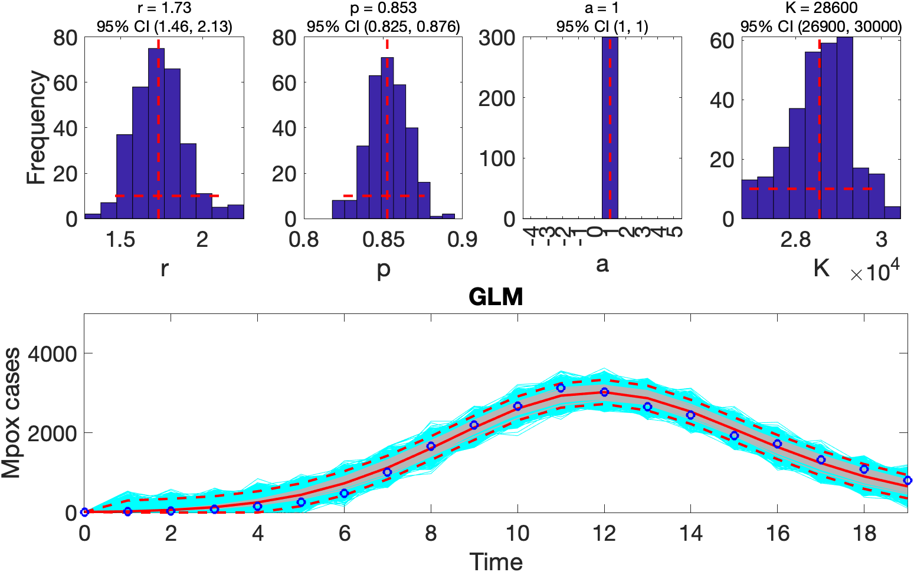
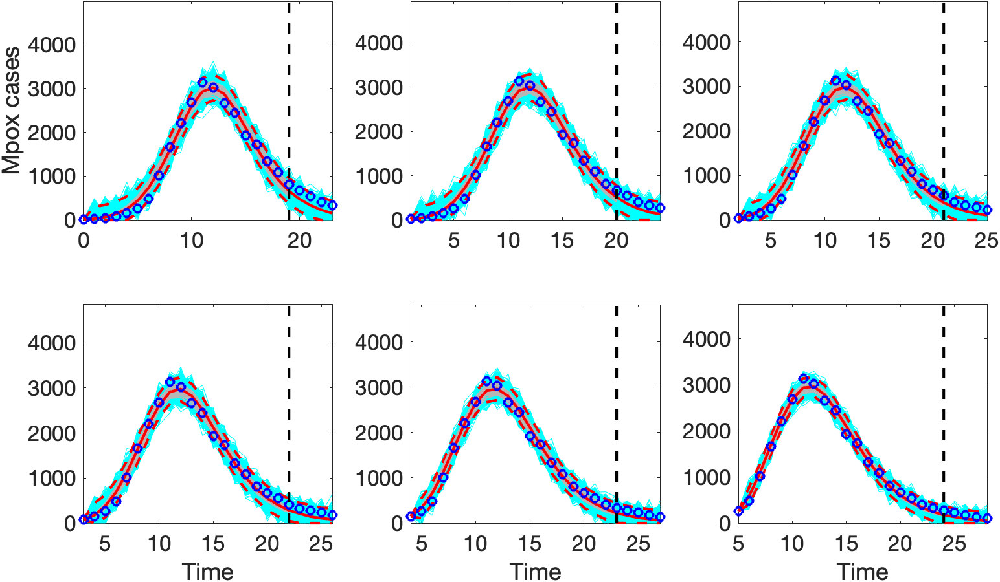
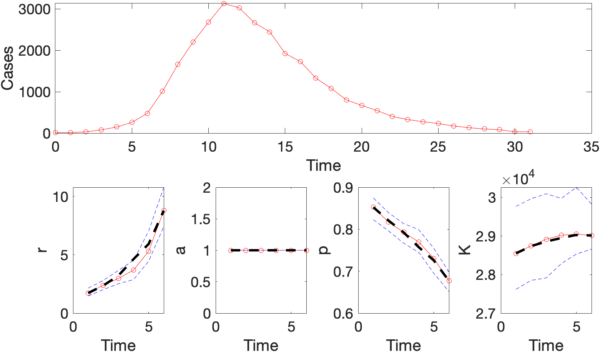

# GrowthPredict

GrowthPredict is a MATLAB toolbox for fitting phenomenological growth models to incidence data and forecasting how many new events will occur in each of the next few observation intervals. Fit one of seven models to a single calibration window, or repeat the analysis across overlapping windows to evaluate forecasts against held-out observations. The toolbox uses a parametric bootstrap to quantify uncertainty in model parameters and predictions.

[Quick start](#quick-start) · [Models](#growth-models) · [Fitting and uncertainty](#fitting-and-uncertainty) · [Outputs and diagnostics](#outputs-and-diagnostics) · [Tutorial paper](https://doi.org/10.1038/s41598-024-51852-8) · [Video tutorials](https://www.youtube.com/watch?v=op93_wUeXXA&list=PLiMOXVNNZfvYLdwNKrIdBmH5NTvGk6IG2)

## Installation

Clone the repository or download and extract the ZIP from GitHub.

```bash
git clone https://github.com/gchowell/GrowthPredict-Toolbox.git
```

In MATLAB, set the **Current Folder** to the repository root, then enter the code folder. Its name contains a space. Run the examples from this folder so the functions can find `input/` and write to `output/`.

```matlab
cd(fullfile(pwd, 'forecasting_growthmodels code'))
```

| MATLAB product | Where it is used |
| --- | --- |
| Optimization Toolbox | Constrained parameter estimation with `fmincon`. |
| Global Optimization Toolbox | Optimization from multiple starting points with `MultiStart`. |
| Statistics and Machine Learning Toolbox | Sampling from the observation distributions and evaluating generation-interval distributions. |
| Curve Fitting Toolbox | The multi-window forecast plotting functions call `smooth` for parameter trends. The single-window example below uses the first three products. |
| Parallel Computing Toolbox | Optional for parallel local solves in `fit_model`. The supplied runners use serial optimization. |

## Quick start

Forecast four observations from the first 20 observations of the bundled U.S. mpox series. The forecast runner fits the model itself, so this example can be run immediately after installation.

```matlab
rng(1, 'twister');
Run_Forecasting_GrowthModels(1, 1, 20, 4);
plotForecast_GrowthModels(1, 1, 20, 4);
```

<p align="center">
  
</p>

*Quick-start output. **Top:** bootstrap distributions of $r$, $p$, $a$ and $K$. The red dashed vertical line marks the fit to the observed data and the red dashed horizontal segment its 95% interval; $a$ is fixed at 1 in the generalized logistic model. **Bottom:** observations (blue circles), bootstrap trajectories with observation noise (cyan), predictive median and 95% prediction limits (red), fitted calibration trajectories (grey) and the end of the calibration window (black dashed line).*

The first two arguments are the first and last **window-start rows**. Setting both to `1` selects one window. The third argument gives the calibration length and the fourth gives the forecast horizon. In this example, rows 1–20 are used for fitting and rows 21–24 are held out. The input time index starts at zero, so the four forecast targets have time labels 20–23. [Example data](forecasting_growthmodels%20code/input/Most_Recent_Timeseries_US-CDC.txt)

Open the trajectory file to see the forecasts beside the four held-out counts (669, 546, 404 and 329). The `median`, `LB` and `UB` columns give the predictive median and the 95% prediction limits.

```matlab
file = 'Forecast-flag1-1-fixI0-1-method-0-dist-0-tstart-1-calibrationperiod-20-horizon-4-Mpox-cases.csv';
trajectory = readtable(fullfile('output', file));
disp(trajectory(end-3:end, :))
```

For a **fit-only analysis** of the same 20 observations, run the following pair. Each plotting function reads the MAT file saved by its corresponding runner. Use matching options and window arguments when plotting.

```matlab
rng(1, 'twister');
Run_Fit_GrowthModels(1, 1, 20);
plotFit_GrowthModels(1, 1, 20);
```

<details>
<summary>Fit-only output</summary>
<br>
<p align="center">
  
</p>

*Same layout as the forecast figure, without forecast rows: parameter distributions with the fitted estimate (red dashed vertical line) and 95% interval, and the fitted trajectories over the 20 calibration observations.*

</details>

### Defaults and custom options

The default fit and forecast options select the generalized logistic model (`flag1 = 1`), fix the initial state (`fixI0 = 1`), and use unweighted least squares with Gaussian noise (`method1 = 0`, `dist1 = 0`). Both set `numstartpoints = 10`. The window length and number of bootstrap datasets depend on the runner.

| Calling the runner without arguments | Window-start rows | Calibration length | Forecast horizon | Bootstrap datasets per window (`B`) |
| --- | --- | ---: | ---: | ---: |
| `Run_Fit_GrowthModels()` with [`options_fit.m`](forecasting_growthmodels%20code/options_fit.m) | 1 to 1 | 20 | 0 | 300 |
| `Run_Forecasting_GrowthModels()` with [`options_forecast.m`](forecasting_growthmodels%20code/options_forecast.m) | 1 to 1 | 10 | 4 | 100 |

The quick start overrides the forecast calibration length to 20. To keep a separate configuration for each analysis, copy the appropriate options function, give the file and its function the same new name, and retain its output order and its `global method1` assignment. Pass the function handle as the last argument to both the runner and the plotter. An empty argument (`[]`) uses the corresponding value from the options function.

The following example repeats the four-step forecast using Poisson maximum likelihood. The bundled negative-binomial configuration uses `@options_forecast_nb` in the same position. [Poisson options](forecasting_growthmodels%20code/options_forecast_pois.m) · [Negative-binomial options](forecasting_growthmodels%20code/options_forecast_nb.m)

```matlab
opts = @options_forecast_pois;
rng(1, 'twister');
Run_Forecasting_GrowthModels(1, 1, 20, 4, opts);
plotForecast_GrowthModels(1, 1, 20, 4, opts);
```

For a fit-only analysis, the options handle is the fourth argument to both functions. A bundled GLM example fits a simulated series with known growth parameters. Other configurations cover cholera and country-specific mpox series. Check the input filename and window settings when adapting an example. [Simulated GLM fit options](forecasting_growthmodels%20code/options_fit_GLM.m) · [Example datasets](forecasting_growthmodels%20code/input)

For a fit of `w` observations in a file with `N` rows, the last possible window starts at row `N - w + 1`. The following examples each fit the last 20 observations of the indicated file. Use the same start row for both window arguments to fit one window.

| Fit options | Input file | Rows in file | Calibration rows |
| --- | --- | ---: | --- |
| [`options_fit_mpox`](forecasting_growthmodels%20code/options_fit_mpox.m) or [`options_fit_mpoxCDC`](forecasting_growthmodels%20code/options_fit_mpoxCDC.m) | `Most_Recent_Timeseries_US-CDC.txt` | 32 | 13–32 |
| [`options_fit_fluAlaska`](forecasting_growthmodels%20code/options_fit_fluAlaska.m) | `curve1.txt` | 50 | 31–50 |

```matlab
Run_Fit_GrowthModels(13, 13, 20, @options_fit_mpoxCDC);
plotFit_GrowthModels(13, 13, 20, @options_fit_mpoxCDC);
```

## Input data

Place a numeric, headerless, two-column text file in `input/`. Set `cadfilename1` to its filename, with or without `.txt`. Set `caddisease` and `datatype` to the labels to use in plots and CSV filenames.

| Column | Contents |
| --- | --- |
| 1 | Ordered time index with unit spacing, such as `0, 1, 2, …`. One step represents one day for daily data or one week for weekly data. |
| 2 | Incidence during each interval. Use nonnegative integer observations for Poisson or negative-binomial likelihoods. Resolve missing intervals and reporting corrections before fitting. |

For **cumulative** observations, begin the filename with `cumulative` (case-insensitive). The loader keeps the first value and differences subsequent rows, giving `[C(1); diff(C)]`. If the first count includes events from before the first observation interval, prepare the incidence series explicitly. A zero in the first row of a calibration window triggers a warning and the runners substitute `0.01` for that observation during fitting.

## Growth models

The model evolves a cumulative state $C(t)$. The solver returns interval incidence as `abs([C(1); diff(C)])`, using the initial state as the first fitted value. With `fixI0 = 1`, the first observation in each window determines that state, subject to the zero replacement above. With `fixI0 = 0`, the optimizer estimates it. Set `flag1` and `model_name1` together. [Model equations](forecasting_growthmodels%20code/modifiedLogisticGrowth.m) · [Incidence calculation](forecasting_growthmodels%20code/growthIncidenceCurve.m)

| `flag1` | `model_name1` | Model | $dC/dt$ |
| ---: | --- | --- | --- |
| −1 | `'EXP'` | Exponential | $rC$ |
| 0 | `'GGM'` | Generalized growth | $rC^p$ |
| 1 | `'GLM'` | Generalized logistic | $rC^p(1-C/K)$ |
| 2 | `'GRM'` | Generalized Richards | $rC^p[1-(C/K)^a]$ |
| 3 | `'LM'` | Logistic | $rC(1-C/K)$ |
| 4 | `'RICH'` | Richards | $rC[1-(C/K)^a]$ |
| 5 | `'GOM'` | Gompertz with time-dependent growth rate | $rC\exp(-at)$ |

Here $r$ sets the growth scale, $p$ is the growth exponent, $K$ is the saturation level in the logistic and Richards families, and $a$ controls shape or, for Gompertz, the decay of the growth rate. Parameter exports use a common set of columns. Interpret only parameters estimated for the selected model and error distribution.

## Fitting and uncertainty

The options function sets `method1` (the fitting criterion) and `dist1` (the observation noise used in simulations). Here $\mu$ is the fitted incidence, $\alpha$ is dispersion and $d$ is the variance exponent. [Fitting objective](forecasting_growthmodels%20code/growthObjectiveValue.m) · [Observation noise](forecasting_growthmodels%20code/AddErrorStructure.m)

| `method1` | Fit to observations | Bootstrap and predictive noise |
| ---: | --- | --- |
| 0 | Unweighted nonlinear least squares, minimizing $\sum_i (y_i-\mu_i)^2$ | `dist1` selects the noise for bootstrap datasets and predictive draws. Choose `0` for Gaussian, `1` for Poisson or `2` for negative binomial with variance $\phi\mu$. |
| 1 | Poisson maximum likelihood | `dist1 = 1`, variance $\mu$. |
| 3 | Negative-binomial maximum likelihood | `dist1 = 3`, variance $\mu + \alpha\mu$. |
| 4 | Negative-binomial maximum likelihood | `dist1 = 4`, variance $\mu + \alpha\mu^2$. |
| 5 | Negative-binomial maximum likelihood | `dist1 = 5`, variance $\mu + \alpha\mu^d$. |

For likelihood fits, the options functions set `dist1` automatically. For least squares with `dist1 = 2`, the runners estimate Pearson dispersion from residuals around the fitted curve. They exclude fitted means below 0.5 and the fixed first point, when applicable. If the estimate is unavailable or $\phi \leq 1$, the window uses Poisson draws. The filename retains `dist-2`. The window MAT file records `dist1_boot` and `poissonFallback`. Gaussian draws can be negative. [Dispersion estimator](forecasting_growthmodels%20code/estimatePearsonDispersion.m)

### Optimization and bootstrap

The optimizer searches the free parameters in scaled coordinates, using a log scale for positive free $r$, $K$ and $\alpha$ by default. For the observed data, `numstartpoints` sets the number of starts distributed across the parameter bounds. The solver adds the initial guess and up to three perturbations of it. If a data-derived bound limits $r$, the solver can retry with wider bounds and retain an improved fit. [Optimizer](forecasting_growthmodels%20code/fit_model.m)

For each window, the runner generates `B` simulated calibration datasets and refits each one using the observed-data estimate and its final bounds. Each refit starts from that estimate, a perturbed copy and one start distributed across the bounds. The 2.5th and 97.5th percentiles of the refitted parameters give the parameter intervals. For prediction, each refitted trajectory supplies 20 additional draws of observation noise. The first value is held fixed when generating each noisy trajectory.

### Comparing fits with AICc

The small-sample corrected Akaike information criterion (AICc) uses the Gaussian likelihood with an estimated residual variance for least squares, and the full count likelihood for Poisson and negative-binomial fits. With `fixI0 = 1`, the calculation conditions on the first observation, leaving $n_{\mathrm{eff}}=n-1$ for a window of length $n$. With `fixI0 = 0`, $n_{\mathrm{eff}}=n$ and the estimated initial state counts toward the parameter count $k$.

Compare candidate models on the same observations with the same initial-state treatment. Lower AICc indicates greater relative support under the chosen likelihood. A finite small-sample correction requires $n_{\mathrm{eff}}>k+1$. For example, the default GLM fit has $k=4$ (three growth parameters and one residual variance), so it needs at least seven observations with a fixed initial state. Historical AICc exports can use an earlier calculation. [AICc calculation](forecasting_growthmodels%20code/getAICc.m) · [Count-likelihood adjustment](forecasting_growthmodels%20code/growthAICcCountAdjustment.m)

## Rolling windows and forecast evaluation

This example evaluates four-step forecasts from six successive starting rows.

```matlab
rng(1, 'twister');
Run_Forecasting_GrowthModels(1, 6, 20, 4);
plotForecast_GrowthModels(1, 6, 20, 4);
```

The first window fits rows 1–20 and forecasts rows 21–24. The last fits rows 6–25 and forecasts rows 26–29. For `N` observations and horizon `h`, a fully scored run requires `tend1 + windowsize1 - 1 + h <= N`. With the default `getperformance = 1`, the runner stops if the full horizon cannot be evaluated. For forecasts beyond the series, set `getperformance = 0` in the forecast options. The runner still calls its scoring functions, which can warn about unavailable observations. Predictive quantiles are calculated separately.

<p align="center">
  
</p>

*One panel per window, in window order: observations (blue circles), predictive median and 95% prediction limits (red), and the end of the calibration window (black dashed line). With six windows the panels form a 2-by-3 grid.*

<p align="center">
  
</p>

*Parameter estimates across windows. **Top:** the observed series. **Bottom:** for each window start, the estimate of $r$, $a$, $p$ and $K$ (red circles), its 95% bootstrap interval (blue dashed lines) and a smoothed trend (black dashed line).*

Forecast scores at horizon `h` summarize **all of the first `h` held-out observations**. For example, the four-step MAE averages four absolute errors. MAE and MSE use the median across refitted model trajectories. Coverage of the 95% prediction interval (reported as a percentage) and the weighted interval score (WIS) use trajectories with observation noise. The rolling summary records the full requested horizon for each window. [Point errors and coverage](forecasting_growthmodels%20code/computeforecastperformance.m) · [WIS](forecasting_growthmodels%20code/computeWIS.m)

<p align="center">
  
</p>

*Forecast performance of the quick-start forecast against horizon: MAE, MSE, coverage of the 95% prediction interval and WIS. The value at horizon $h$ summarizes the first $h$ held-out observations.*

## Outputs and diagnostics

The runners write results to `output/`. In rolling summaries, `time` is the one-based window-start row. In trajectory files it is the input time label. The second MATLAB output of either runner contains the bootstrap model trajectories for the **last** window processed. The per-window MAT files retain the other windows.

| Output in `output/` | What to read |
| --- | --- |
| `parameters-rollingwindow-*.csv` | The columns labeled `estimate` contain the **fit to the observed data**. `LB` and `UB` are bootstrap percentile limits. The exported label `K0` denotes $K$. |
| `diagnostics-rollingwindow-*.csv` | Each window's optimizer agreement statistic (`startAgreement`) and each parameter's bootstrap median, lower- and upper-bound hit fractions, flag for an estimate outside its interval, and flag for a best fit on a bound. |
| `AICcs-rollingwindow-*.csv` | AICc, its likelihood and penalty components, and the parameter count. |
| `MCSES-rollingwindow-*.csv`, `SCIS-rollingwindow-*.csv` | The bootstrap standard deviation divided by $\sqrt{B}$ (Monte Carlo standard error of the bootstrap mean) and the interval span $\log_{10}(\mathrm{UB}/\mathrm{LB})$, respectively. The log span requires positive limits. |
| `Fit-*.csv`, `Forecast-*.csv` | Observations, predictive median and 95% prediction limits from the plotting functions. A forecast file contains calibration rows followed by forecast rows. For projections beyond the data, future time labels and observations can both be `NaN`. Use the MAT file's `timevect2` for forecast times. |
| `quantile-fit-*.csv`, `quantile-forecast-*.csv` | 23 predictive quantiles from 0.010 to 0.990. Rows match the trajectory file in order. Use that file or `timevect2` for time labels. |
| `performance-calibration-*.csv`, `performance-forecasting-*.csv` | Calibration length or forecast horizon, MAE, MSE, 95% prediction interval coverage and WIS. The performance MAT files also store RMSE and mean interval score. |
| `Forecast-growthModel-*.mat` | One workspace per window, including `P_model1d` (observed-data estimate), `Phatss_model1` (bootstrap parameter draws), `fitDiagnostics_model1d` (optimizer details) and `forecast_model12` (predictive draws). Fit-only filenames have `forecastingperiod-0`. |

When reading a parameter interval, first check whether the best fit reached a bound and how often refits reached that same bound. A displayed interval endpoint can reflect an optimizer limit. The runners warn when more than 5% of refits hit either individual bound, when the observed-data estimate lies outside its bootstrap interval, or when `startAgreement` is below 0.5. This last statistic compares the converged local solutions returned by `MultiStart` with the best objective. Fixed parameters have `NaN` bound-hit fractions. [Bound-hit calculation](forecasting_growthmodels%20code/boundHitFractions.m)

The console reports requested, accepted and unresolved bootstrap fits. Acceptance requires a positive exit flag and finite objective. A refit that returns a finite fallback estimate with a nonpositive exit flag still contributes to the summaries. Inspect unresolved counts and warnings before reporting intervals.

## Reproduction numbers and doubling times

The growth-model plots also export `doublingtimes-*.csv` from the fitted calibration trajectories. Each row describes a successive doubling of cumulative incidence, with its mean elapsed time, percentile limits and the fraction of bootstrap trajectories reaching that doubling.

To estimate the effective reproduction number $R_t$, first run the matching fit or forecast. The final argument to each plotting function is an options function, such as `@options_Rt`. It takes no inputs and returns `[type_GId1, mean_GI1, var_GI1]`. To use different settings, copy the options function and pass its handle. [Generation-interval options](forecasting_growthmodels%20code/options_Rt.m)

| `type_GId1` | Generation interval | Settings used |
| ---: | --- | --- |
| 1 | Gamma | Mean in observation-time units and variance in squared units |
| 2 | Exponential | Mean in observation-time units |
| 3 | Fixed | A positive lag in multiples of 0.01 observation-time units |

```matlab
plotFit_ReproductionNumber(1, 1, 20, @options_fit, @options_Rt);
plotForecast_ReproductionNumber(1, 1, 20, 4, @options_forecast, @options_Rt);
```

<p align="center">
  
</p>

*Output of `plotFit_ReproductionNumber` for the fit-only example. **Top:** observations and fitted trajectories. **Bottom:** median $R_t$ (solid red) with its 95% interval (red dashed), the threshold $R_t = 1$ and the end of the calibration window (black dashed lines).*

The renewal calculation interpolates incidence on a 0.01-unit grid and uses the incidence history within the window. The gamma and exponential routines evaluate their distribution on the supplied time axis, so use a window starting at time zero to interpret the grid as elapsed lag. For a fixed lag $g$, the estimate is $I(t)/I(t-g)$ wherever the lagged incidence is available and positive. Earlier versions of `get_Rt.m` placed the fixed lag one grid step late. [Renewal calculation](forecasting_growthmodels%20code/get_Rt.m)

For exact timing, pair the values returned by `get_Rt` with `ts(2:end)`. In the `Rt-*.csv` export, the time labels before the final row are 0.01 units earlier than the corresponding estimates.

## Reproducibility and support

To regenerate all six README figures from a fresh checkout, run the following command from the code folder. It resets the random seed to `rng(1, 'twister')` before each runner and writes the PNGs to `docs/images/`. The rolling-window parameter plot uses the Curve Fitting Toolbox. [Figure-generation script](forecasting_growthmodels%20code/make_readme_figures.m)

```matlab
make_readme_figures
```

After the full run, `make_readme_figures(false)` redraws the figures from the saved MAT files. It needs the 20-observation fit starting at row 1, the single-window four-step forecast starting at row 1, and the six-window four-step forecast starting at rows 1–6. The historical MAT files bundled in `output/` use other settings.

Record the repository revision (`git rev-parse HEAD`), MATLAB and toolbox versions (`ver`), input data, options functions, window arguments and random seed. Output filenames omit the seed, `B` and some optimizer settings, so archive results before rerunning with those settings changed. The repository also includes historical outputs.

If plotting cannot find a MAT file, check that the runner and plotter use the same working folder, options, window range and horizon. To report an issue, include the commands, relevant options, error or warning text and a small shareable example. For a code contribution, describe the expected behavior and include a regression test. [GitHub Issues](https://github.com/gchowell/GrowthPredict-Toolbox/issues)

## Citation and license

Chowell, G., Bleichrodt, A., Dahal, S., et al. (2024). GrowthPredict: A toolbox and tutorial-based primer for fitting and forecasting growth trajectories using phenomenological growth models. *Scientific Reports*, **14**, 1630. [Tutorial paper](https://doi.org/10.1038/s41598-024-51852-8) · [Software citation](CITATION.cff)

Related methods include Chowell (2017) on fitting dynamic models with quantified uncertainty and Bürger, Chowell and Lara-Díaz (2019) on comparing phenomenological growth models. [Uncertainty primer](https://doi.org/10.1016/j.idm.2017.08.001) · [Growth-model comparison](https://doi.org/10.3934/mbe.2019212)

GrowthPredict is distributed under the GNU General Public License v3.0 only. [License](LICENSE)
