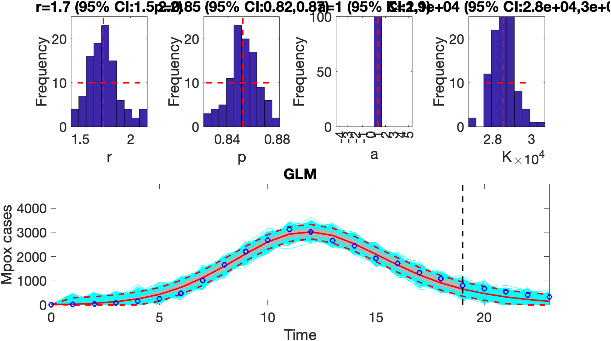
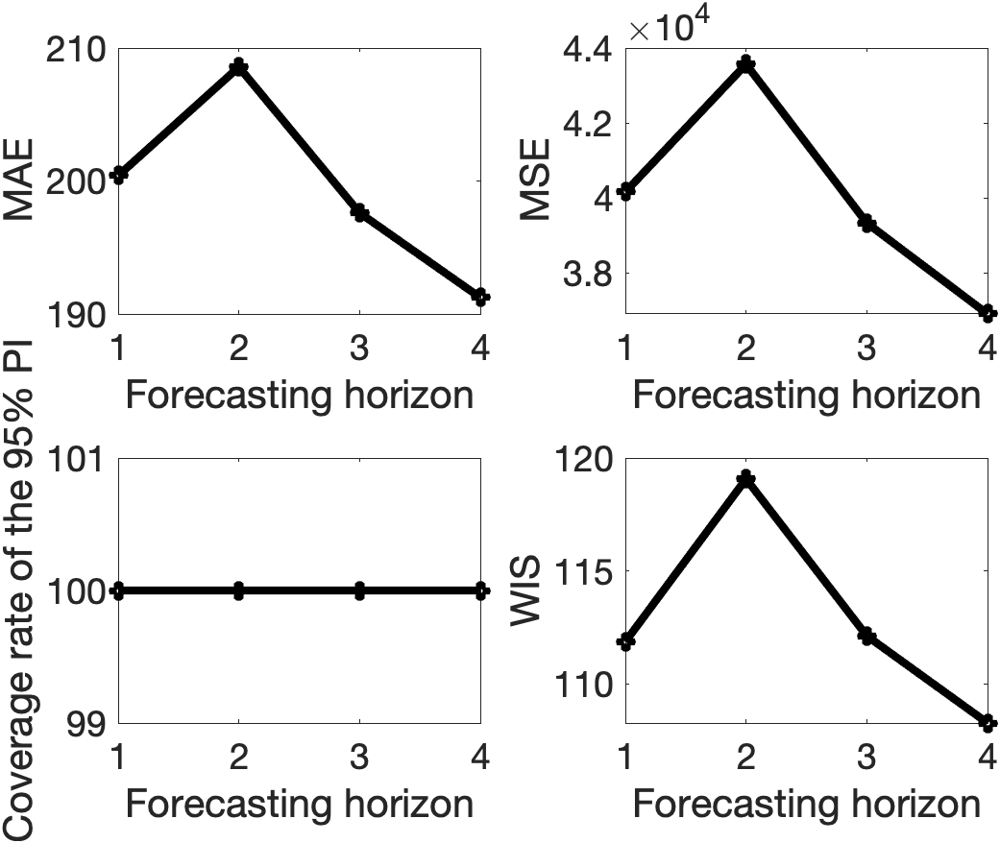
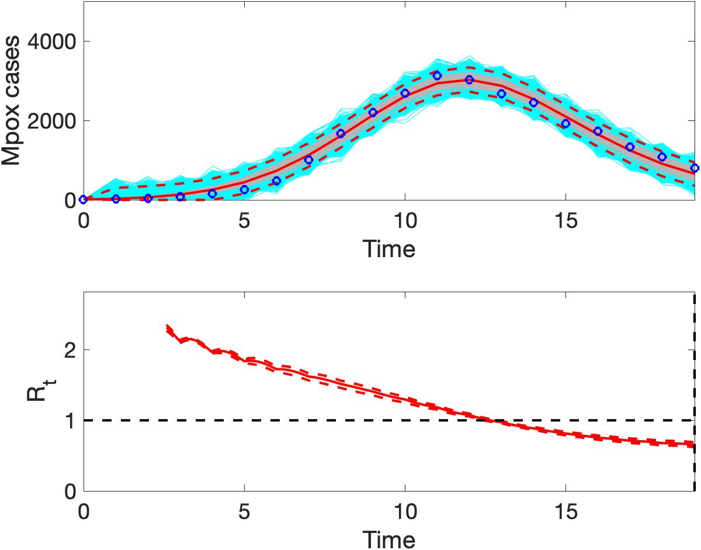

# GrowthPredict

GrowthPredict is a MATLAB toolbox for fitting seven phenomenological growth models to incidence time series and forecasting new cases per observation interval. Use a single calibration window to study one growth trajectory, or move the window through a series to evaluate forecasts against observations held out at each step. A parametric bootstrap gives uncertainty intervals for model parameters and predictions.

[Quick start](#quick-start) · [Use your own data](#use-your-own-data) · [Growth models](#growth-models) · [Forecast evaluation](#rolling-windows-and-forecast-evaluation) · [Output files](#output-files) · [Tutorial paper](https://doi.org/10.1038/s41598-024-51852-8) · [Video tutorials](https://www.youtube.com/watch?v=op93_wUeXXA&list=PLiMOXVNNZfvYLdwNKrIdBmH5NTvGk6IG2)

## Installation

Download and extract the ZIP from GitHub, or clone the repository in a terminal.

```bash
git clone https://github.com/gchowell/GrowthPredict-Toolbox.git
```

In MATLAB, set the **Current Folder** to the repository root, then run the following command. Keep this code folder as the working directory. The runners look for data in `input/` and create `output/` if needed.

```matlab
cd(fullfile(pwd, 'forecasting_growthmodels code'))
```

| MATLAB product | When you need it |
| --- | --- |
| Optimization Toolbox and Global Optimization Toolbox | The fitting and forecasting runners use `fmincon` and `MultiStart`. |
| Statistics and Machine Learning Toolbox | The runners draw bootstrap observations. The reproduction-number routines also use distribution functions. |
| Curve Fitting Toolbox | Multi-window forecast plots use `smooth` to draw parameter trends. |
| Parallel Computing Toolbox | Optional when enabling parallel local solves in `fit_model`. The supplied runners use serial optimization. |

## Quick start

Fit the generalized logistic model to the first 20 observations of the bundled U.S. mpox series and forecast the next four. The forecast runner performs the fit. The plotter reads the saved result and exports the trajectory and predictive quantiles. [Example data](forecasting_growthmodels%20code/input/Most_Recent_Timeseries_US-CDC.txt)

```matlab
rng(1, 'twister');
Run_Forecasting_GrowthModels(1, 1, 20, 4);
plotForecast_GrowthModels(1, 1, 20, 4);
```

The arguments are the **first window-start row**, **last window-start row**, **calibration length**, and **forecast horizon**, in that order. The two `1`s select a single window. Rows 1–20 are used for fitting. Rows 21–24 are held out.

Read the last four rows of the trajectory CSV to see the forecast alongside the observed counts.

```matlab
file = 'Forecast-flag1-1-fixI0-1-method-0-dist-0-tstart-1-calibrationperiod-20-horizon-4-Mpox-cases.csv';
trajectory = readtable(fullfile('output', file));
disp(trajectory(end-3:end, {'time','data','median','LB','UB'}))
```

The four time labels are **20, 21, 22, 23**, and the observed counts are **669, 546, 404, 329**. These values come directly from the input file and provide a check on the forecast window. The other three columns give the predictive median and the lower and upper 95% prediction limits.



*The vertical dashed line in the incidence panel marks the last calibration observation. Blue circles show observations, the solid red curve is the predictive median, and dashed red curves give the 95% prediction limits. In the parameter histograms, the vertical red mark is the estimate from the observed data. The generalized logistic model fixes $a=1$.*

<details>
<summary>Fit the same window without forecasting</summary>

```matlab
rng(1, 'twister');
Run_Fit_GrowthModels(1, 1, 20);
plotFit_GrowthModels(1, 1, 20);
```


</details>

### Settings used by the examples

Both default options functions select the generalized logistic model, fix the initial state to the first observation, and use unweighted least squares with Gaussian observation noise. Both set `numstartpoints = 10`. Calling a runner with no arguments uses these window and bootstrap settings.

| Runner | Options function | Window-start rows | Calibration length | Forecast horizon | Bootstrap datasets per window (`B`) |
| --- | --- | --- | ---: | ---: | ---: |
| `Run_Fit_GrowthModels` | [options_fit.m](forecasting_growthmodels%20code/options_fit.m) | 1 to 1 | 20 | 0 | 300 |
| `Run_Forecasting_GrowthModels` | [options_forecast.m](forecasting_growthmodels%20code/options_forecast.m) | 1 to 1 | 10 | 4 | 100 |

The quick start explicitly sets the forecast calibration length to 20. A window or horizon argument of `[]` uses the value in the options function.

## Use your own data

1. Put a **headerless, two-column numeric text file** in `input/`. Column 1 is an ordered, unit-spaced time index, such as `0, 1, 2, …`. Column 2 is the number of new events in each interval. One forecast step represents one observation interval. Use nonnegative integer counts for Poisson and negative-binomial likelihoods, and resolve missing intervals and reporting corrections before fitting.
2. Copy `options_forecast.m` to a new file, for example `options_forecast_study.m`. Change the function name in its declaration to match the new filename. Preserve the output order and the `global method1` declaration.
3. Set `cadfilename1` to the input filename, with or without `.txt`. Set `caddisease` and `datatype` to labels that identify the series in plots and CSV filenames. Choose the model and fitting method from the tables below.
4. Pass the options function to **both** the runner and plotter. These calls use the window and horizon saved in your new options file.

```matlab
opts = @options_forecast_study;
rng(1, 'twister');
Run_Forecasting_GrowthModels([], [], [], [], opts);
plotForecast_GrowthModels([], [], [], [], opts);
```

For fitting alone, copy `options_fit.m` and pass the handle as the **fourth** argument to the fit runner and plotter. The repository includes a simulated growth curve with known parameters and examples of Poisson and negative-binomial forecast configurations. [Simulated GLM fit](forecasting_growthmodels%20code/options_fit_GLM.m) · [Poisson forecast options](forecasting_growthmodels%20code/options_forecast_pois.m) · [Negative-binomial forecast options](forecasting_growthmodels%20code/options_forecast_nb.m) · [Input datasets](forecasting_growthmodels%20code/input)

**Cumulative data.** Begin the filename with `cumulative` (case-insensitive) to convert a cumulative series to incidence on load. The conversion is `[C(1); diff(C)]`. For example, cumulative counts of 10, 14 and 21 become interval counts of 10, 4 and 7. If the first total includes cases from before the study window, prepare interval counts explicitly.

**A window starting at zero cases.** The runners issue a warning and replace its first observed count with `0.01` for fitting. This substitution also occurs with `fixI0 = 0`. Record it when interpreting a fit to sparse counts.

## Growth models

The solver evolves a cumulative state $C(t)$ and obtains interval incidence from `abs([C(1); diff(C)])`. The initial state supplies the first fitted value. Set `fixI0 = 1` to fix it to the first observation in each window or `0` to estimate it. Set `flag1` and `model_name1` together. [Model equations](forecasting_growthmodels%20code/modifiedLogisticGrowth.m) · [Incidence calculation](forecasting_growthmodels%20code/growthIncidenceCurve.m)

| `flag1` | `model_name1` | Model | $dC/dt$ |
| ---: | --- | --- | --- |
| -1 | `'EXP'` | Exponential | $rC$ |
| 0 | `'GGM'` | Generalized growth | $rC^p$ |
| 1 | `'GLM'` | Generalized logistic | $rC^p(1-C/K)$ |
| 2 | `'GRM'` | Generalized Richards | $rC^p[1-(C/K)^a]$ |
| 3 | `'LM'` | Logistic | $rC(1-C/K)$ |
| 4 | `'RICH'` | Richards | $rC[1-(C/K)^a]$ |
| 5 | `'GOM'` | Gompertz with a time-dependent growth rate | $rC\exp(-at)$ |

Here $r$ sets the growth scale, $p$ is the growth exponent, and $K$ is the saturation level in the logistic and Richards families. The parameter $a$ controls shape in the Richards models and growth-rate decay in the Gompertz model. The output tables share one layout across models, so interpret only the parameters estimated in your run.

## Fitting and uncertainty

`method1` selects the fitting criterion. `dist1` selects the observation noise used to generate bootstrap datasets and predictive draws. In the table, $\mu$ denotes fitted incidence, $\alpha$ is a dispersion parameter and $d$ is a variance exponent. [Fitting objective](forecasting_growthmodels%20code/growthObjectiveValue.m) · [Observation noise](forecasting_growthmodels%20code/AddErrorStructure.m)

| `method1` | Fit | Choice of `dist1` |
| ---: | --- | --- |
| 0 | Unweighted nonlinear least squares | `0` Gaussian, `1` Poisson, or `2` negative binomial with variance $\phi\mu$. All three minimize the same sum of squared errors. |
| 1 | Poisson maximum likelihood | `1` with variance $\mu$ |
| 3 | Negative-binomial maximum likelihood | `3` with variance $\mu+\alpha\mu$ |
| 4 | Negative-binomial maximum likelihood | `4` with variance $\mu+\alpha\mu^2$ |
| 5 | Negative-binomial maximum likelihood | `5` with variance $\mu+\alpha\mu^d$ |

For likelihood fits, the default options set `dist1` automatically. For least squares with `dist1 = 2`, the runners estimate Pearson dispersion from residuals about the fitted curve, excluding fitted means below 0.5 and the first observation when fixed. If $\phi\leq1$ or the estimate is unavailable, that window uses Poisson draws. The filename still contains `dist-2`. Check `dist1_boot` and `poissonFallback` in the window MAT file for the noise model actually used. [Dispersion estimator](forecasting_growthmodels%20code/estimatePearsonDispersion.m)

**Parameter intervals.** For the observed-data fit, `numstartpoints` controls the number of starts spread across the parameter bounds. The optimizer also tries the initial guess and nearby points. The runner then generates `B` calibration datasets and refits each using the observed-data estimate and its final bounds. The reported point estimate comes from the observed data. The 2.5th and 97.5th percentiles of the bootstrap estimates give its interval. [Optimizer](forecasting_growthmodels%20code/fit_model.m)

**Prediction intervals.** Each refit supplies a model trajectory. The runner adds observation noise 20 times per trajectory, holding its first value fixed. The predictive quantiles summarize those draws. Gaussian draws can be negative. The trajectory CSV clips negative interval limits at zero, and the quantile CSV clips negative quantiles at zero.

**Model comparison.** Compare the small-sample corrected Akaike information criterion (AICc) across models fitted to the same observations with the same initial-state treatment. Lower values indicate greater relative support. Least squares uses a Gaussian likelihood with an estimated residual variance for every choice of `dist1`. Count models use their count likelihood. With a fixed initial state, $n_{\mathrm{eff}}=n-1$ for a window of length $n$. With an estimated initial state, $n_{\mathrm{eff}}=n$ and the initial state counts toward $k$, the number of estimated quantities. A finite correction requires $n_{\mathrm{eff}}>k+1$. For the default generalized logistic model, $k=4$, so at least seven observations are needed. [AICc calculation](forecasting_growthmodels%20code/getAICc.m) · [Parameter count](forecasting_growthmodels%20code/get_nparams.m)

## Rolling windows and forecast evaluation

To evaluate six successive four-step forecasts of the bundled series, advance the start row from 1 through 6.

```matlab
rng(1, 'twister');
Run_Forecasting_GrowthModels(1, 6, 20, 4);
plotForecast_GrowthModels(1, 6, 20, 4);
```

| Window | Calibration rows | Held-out rows |
| --- | --- | --- |
| First | 1–20 | 21–24 |
| Last | 6–25 | 26–29 |

**Retrospective evaluation.** With `getperformance = 1`, the runner requires observations for the entire forecast horizon. For a series of length `N`, the last requested window must satisfy `tend1 + windowsize1 - 1 + forecastingperiod <= N`.

**Forecasting beyond the data.** Set `getperformance = 0` in your forecast options. To fit the last complete window, use `N - windowsize1 + 1` as both window-start rows. The runner still calls scoring routines, which can warn when future observations are unavailable. Predictive quantiles are calculated separately. Use the saved `timevect2` for target times beyond the observed series.

**Reading a score.** A score plotted at horizon $h$ summarizes the **first $h$ held-out observations together**. For example, the four-step mean absolute error (MAE) averages four absolute errors. MAE and mean squared error (MSE) use the median across refitted trajectories **before** observation noise is added. The `median` in the forecast CSV, 95% prediction interval coverage, and weighted interval score (WIS) use draws **after** observation noise is added. A calculation using the CSV median can therefore give a different MAE. Coverage is reported as a percentage. The rolling performance CSV gives one score per window at the full requested horizon. [Point errors and coverage](forecasting_growthmodels%20code/computeforecastperformance.m) · [WIS](forecasting_growthmodels%20code/computeWIS.m)

<details>
<summary>Example forecasts, parameter estimates and performance plots</summary>


*Each panel advances the calibration window by one observation. The dashed vertical line marks the last observation available for that forecast.*


*Red circles show the observed-data parameter estimates for each window. Blue dashed lines give their bootstrap limits.*



*The four panels summarize the single-window forecast as each successive held-out observation is included.*

</details>

## Output files

All paths below are relative to `output/`. In a rolling summary, `time` identifies the **one-based window-start row**. In a trajectory CSV, `time` is the **input time label**. The quantile CSV follows the same row order as its trajectory CSV.

| To find | Open | What it contains |
| --- | --- | --- |
| Fitted or forecast incidence | `Fit-*.csv`, `Forecast-*.csv` | The plotter exports `time`, `data`, `median`, `LB` and `UB`. A forecast file starts with calibration rows. Beyond the observed series, both `time` and `data` can be `NaN`. |
| Predictive quantiles | `quantile-fit-*.csv`, `quantile-forecast-*.csv` | The plotter exports 23 quantiles from 0.010 to 0.990. Pair with the trajectory CSV or `timevect2` for time labels. |
| Parameter estimates and intervals | `parameters-rollingwindow-*.csv` | Observed-data estimate and bootstrap limits for each window. The column label `K0` denotes $K$. |
| Optimizer and bootstrap diagnostics | `diagnostics-rollingwindow-*.csv` | Agreement among converged local solutions, bootstrap medians, fractions at each parameter bound, and flags for a best fit on a bound or outside its bootstrap interval. |
| Forecast and calibration scores | `performance-forecasting-*.csv`, `performance-calibration-*.csv` | MAE, MSE, 95% prediction interval coverage and WIS. The performance MAT files also store root mean squared error and mean interval score. |
| Fit comparisons | `AICcs-rollingwindow-*.csv` | AICc, its likelihood and penalty components, and $k$. |
| Monte Carlo error and interval span | `MCSES-rollingwindow-*.csv`, `SCIS-rollingwindow-*.csv` | Bootstrap standard deviation divided by $\sqrt{B}$, the Monte Carlo standard error of the bootstrap mean, and $\log_{10}(\mathrm{UB}/\mathrm{LB})$, respectively. The log span requires positive limits. |
| Saved workspace for each window | `Forecast-growthModel-*.mat` | Includes `P_model1d` (observed-data estimate), `Phatss_model1` (bootstrap estimates), `fitDiagnostics_model1d` (optimizer details), `forecast_model12` (predictive draws) and `timevect2`. Fit-only runs use `forecastingperiod-0`. |

**Before reporting parameter intervals**, check the diagnostic flags and the console count of unresolved refits. The runners flag a bound when more than 5% of refits reach it. They also flag an observed-data estimate outside its interval and optimizer agreement below 0.5. Fixed parameters have `NaN` bound-hit fractions. A refit with a finite fallback estimate and a nonpositive exit flag can contribute to the summaries even though it counts as unresolved. [Bound-hit calculation](forecasting_growthmodels%20code/boundHitFractions.m)

## Reproduction numbers and doubling times

The growth-model plotters export `doublingtimes-*.csv` from the calibration trajectories. For each successive doubling of cumulative incidence, read the elapsed-time summary together with the fraction of bootstrap trajectories that reached that doubling.

To estimate the effective reproduction number $R_t$, first run the matching fit or forecast. In `options_Rt.m`, set `type_GId1` to `1` for gamma, `2` for exponential, or `3` for a fixed interval. Express the mean in observation intervals and the gamma variance in squared intervals. For weekly data, divide a mean in days by 7 and a variance in days squared by 49. [Generation-interval options](forecasting_growthmodels%20code/options_Rt.m)

```matlab
% After the single-window fit
plotFit_ReproductionNumber(1, 1, 20, @options_fit, @options_Rt);

% After the single-window forecast
plotForecast_ReproductionNumber(1, 1, 20, 4, @options_forecast, @options_Rt);
```

<details>
<summary>Example reproduction-number plot and time alignment</summary>



*The lower panel shows the median $R_t$ and its interval. The horizontal dashed line marks $R_t=1$.*

The renewal calculation uses only the incidence history inside the window and interpolates on a 0.01-unit grid. The gamma and exponential routines evaluate generation-interval weights on the supplied time axis. Use a window beginning at time zero for these weights to represent elapsed lags. The fixed-interval option requires a mean on the grid. For exact alignment, pair the values returned by `get_Rt` with `ts(2:end)`. Intermediate rows of the `Rt-*.csv` export label estimates one grid step early. [Renewal calculation](forecasting_growthmodels%20code/get_Rt.m) · [CSV export](forecasting_growthmodels%20code/plotFit_ReproductionNumber.m)

</details>

## Reproducibility and support

Record the input series and its time unit, preprocessing, options functions, window and horizon arguments, seed, bootstrap size, MATLAB and toolbox versions (`ver`), and source revision (`git rev-parse HEAD`). Archive each run before changing settings. CSV filenames use the series labels and omit the seed and bootstrap size, so another run can overwrite them. The repository includes historical outputs. Regenerate results for comparisons under the current code.

If a plotter cannot find its MAT file, run the matching fit or forecast from the code folder using the same options, first and last window-start rows, calibration length and horizon. To report a problem, include those commands, the exact warning or error, and a small reproducible input. [GitHub Issues](https://github.com/gchowell/GrowthPredict-Toolbox/issues)

## Citation and license

Chowell G, Bleichrodt A, Dahal S, Tariq A, Roosa K, Hyman JM, Luo R. GrowthPredict: A toolbox and tutorial-based primer for fitting and forecasting growth trajectories using phenomenological growth models. *Scientific Reports* **14**, 1630 (2024). [Tutorial paper](https://doi.org/10.1038/s41598-024-51852-8) · [Software citation](CITATION.cff)

Related methods cover parameter uncertainty and the comparison of phenomenological growth models. [Chowell (2017)](https://doi.org/10.1016/j.idm.2017.08.001) · [Bürger, Chowell and Lara-Díaz (2019)](https://doi.org/10.3934/mbe.2019212)

GrowthPredict is distributed under the GNU General Public License v3.0 only. [License](LICENSE)
