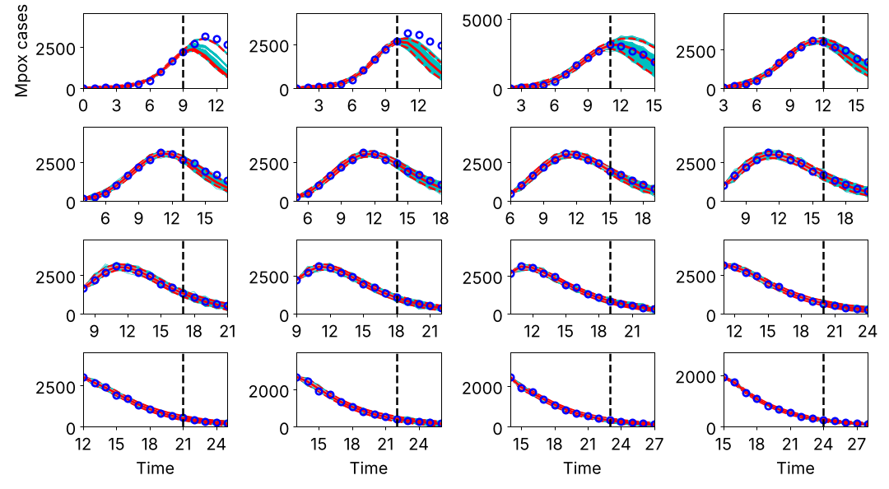
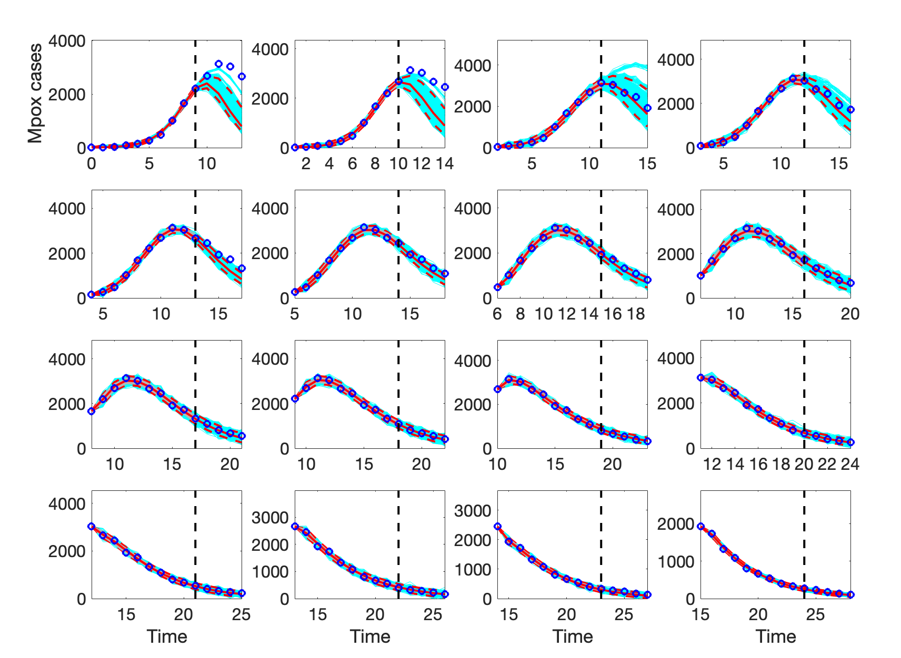

# Plotting functions with many windows or a last window beyond the series: change and test results

Base commit: `64648e7` (v1.1.1). The checks below were run on 27 Nov 2026 in Python (`python/test_plot_windows.py` and the test suite of the Python port in the repository's `python` folder). In MATLAB, `runtests('tests')` passes 60 of 60, including the eleven tests of the two new files, `plotFit_GrowthModels.m`, `plotFit_ReproductionNumber.m` and `plotRt.m` were run after a run with an adjusted last window start, and `plotForecast_GrowthModels.m` drew figure 400 with 16 panels for 16 windows. See [Run in MATLAB](#run-in-matlab).

No fitted value, forecast or exported number changes. Nothing needs to be rerun.

## What changed

| File | Before | After |
| --- | --- | --- |
| `forecastPanelGrid.m` | | New. Rows and columns of figure 400 for any number of windows |
| `plotForecast_GrowthModels.m` | Grid of figure 400 computed inline; with four or more prime factors in the number of windows (16, 24, 32, 36, 40, 48, …) it was 2-by-2 or similar and `subplot` stopped at the fifth window | Calls `forecastPanelGrid.m` |
| `plotForecast_GrowthModels.m` | With more than 11 windows, `close all` at each window also closed figure 400, so it ended with the panel of the last window only | Closes the other figures and keeps figure 400 |
| `plotForecast_GrowthModels.m`, `plotForecast_ReproductionNumber.m` | In the rolling-parameter figure the upper limit of `a` was read from `param_as`, the other eleven limits and estimates from `param_rs2`, `param_as2`, `param_ps2`, `param_Ks2` | All from the `…2` arrays |
| `adjustLastWindowStart.m` | | New. The rule the two runners apply to `tend1` when the series is too short |
| `plotFit_GrowthModels.m`, `plotForecast_GrowthModels.m`, `plotFit_ReproductionNumber.m`, `plotForecast_ReproductionNumber.m`, `plotRt.m` | Used `tend1` as requested, so after a run in which the runner had moved `tend1` back they looked for files the runner had not written | Call `adjustLastWindowStart.m` before the first use of `tend1`. With no window left they print `incompatible tstart and tend values` and return empty outputs, like the runners |
| `tests/test_forecastPanelGrid.m`, `tests/test_adjustLastWindowStart.m` | | Six and five tests (new files); no toolbox needed |

The runners are unchanged.

## 1. Panel of forecasts (figure 400)

The former rule took the grid from the prime factors f1 ≤ f2 ≤ … of the number of windows: n-by-1 for one factor, (f1·f2)-by-f3 for three, and f1-by-f2 otherwise. With four or more factors, f1·f2 is smaller than the number of windows. This holds for 43 of the counts from 1 to 200.

The new rule keeps the first three cases and adds the two-factor case explicitly. For four or more factors it uses d-by-(n/d), where d is the largest divisor of n not above its square root.

| Windows | Former grid (panels) | New grid |
| ---: | --- | --- |
| 6 (README) | 2×3 (6) | 2×3 |
| 12 | 4×3 (12) | 4×3 |
| 16 | 2×2 (4) | 4×4 |
| 24 | 2×2 (4) | 4×6 |
| 32 | 2×2 (4) | 4×8 |
| 36 | 2×2 (4) | 6×6 |
| 54 | 2×3 (6) | 6×9 |
| 80 | 2×2 (4) | 8×10 |

Checked with the port for every count from 1 to 1000: rows × columns equals the number of windows, and the layout is the former one whenever the count has at most three prime factors.

All counts with four or more prime factors are above 11, the point at which the function closes figures at every window. Fixing the grid alone would therefore have left figure 400 with one panel, so the loop now keeps figure 400 open. This also changes figure 400 for 12 to 15 windows, which drew without error before but kept the last panel only.

The Python port of the toolbox uses the same rule. Its output for 16 windows of 10 observations of the U.S. mpox series (`B = 30`):

<p align="center">
  
</p>

## 2. Rolling-parameter figure

`param_as` is the array the runner saved with the last window; `param_as2` is rebuilt by the plotting function from the windows it loads. When the function reaches this figure the two hold the same rows, so **no figure changes**. The line is corrected so that the four panels read one set of arrays.

They hold the same rows because `load` also restores the runner's `tstart1`, and the figure is drawn against `tstart1:tend1`. If a plot is asked for a later first window than the run, the first panel stops on vectors of different lengths before the panel for `a` is reached. That case is not addressed here; see [Known limits](#known-limits).

## 3. Last window start

Rule of the runners, now in `adjustLastWindowStart.m`: if `tend1 + windowsize1 - 1` exceeds the number of rows, `tend1` becomes `rows - windowsize1 + 1`. The runners name each window's MAT file with the adjusted value.

Example, U.S. mpox series (32 rows), `Run_Fit_GrowthModels(1,20,20)` followed by `plotFit_GrowthModels(1,20,20)`:

| | File name contains |
| --- | --- |
| Runner writes | `-tstart-1-tend-13-` |
| Plotting function, before | `-tstart-1-tend-20-` |
| Plotting function, after | `-tstart-1-tend-13-` |

The README examples and the shipped option files with a valid range are not adjusted. `options_fit_mpox.m`, `options_fit_mpoxCDC.m` and `options_fit_fluAlaska.m` as shipped ask for row 37; the last window that fits starts earlier, so runners and plotting functions report that there is nothing to do.

## Test results (Python)

`python/test_plot_windows.py` passes 35 of 35 checks; its output is in `results/plot_windows_output.txt`. It covers:

- the two rules, against brute-force calculations (1000 window counts; 4320 combinations of series length, window length and requested start);
- the `subplot` calls of `plotForecast_GrowthModels.m`, repeated with Matplotlib: the former grid stops at the fifth panel for 16, 24 and 32 windows, the new grid gives one panel per window;
- the expected values written in the two MATLAB test files, against the ports;
- the MATLAB sources: each of the five plotting functions calls `adjustLastWindowStart.m` once, after the data and the window length are known and before `tend1` is used, and assigns every output before returning; the rolling-parameter figures read the `…2` arrays only; figure 400 is no longer closed inside the loop.

The Python port (`python` folder) carries the same three behaviours and tests them end to end, with fits and bootstrap:

| Test in `python/tests/test_runners.py` | Result |
| --- | --- |
| 16 windows (U.S. mpox) and 24 windows (cholera): figure 400 has one panel per window, in 4×4 and 4×6, each showing its own window | Pass |
| Rolling-parameter figure: estimate, both limits and smoothed estimate of each panel come from the same parameter | Pass |
| `Run_Fit_GrowthModels(12,20,20)` then the three fit plotting functions with the same arguments: files named `tend-13`, two windows plotted | Pass |
| Same for a forecast beyond the data (`getperformance = 0`) and the two forecast plotting functions | Pass |
| First window beyond the last possible one: the five plotting functions return empty outputs and open no figure | Pass |

## Run in MATLAB

Run by the maintainer on 27 Nov 2026 from `forecasting_growthmodels code`.

| Check | Result |
| --- | --- |
| `runtests({'tests/test_forecastPanelGrid.m','tests/test_adjustLastWindowStart.m'})` | 11 of 11 pass (6 and 5) |
| `runtests('tests')`, all nine test files | 60 of 60 pass, 0 failed, 0 incomplete (the 49 tests of v1.1.0 and the 11 new ones) |
| `Run_Fit_GrowthModels(12,20,20)` then `plotFit_GrowthModels(12,20,20)`, U.S. mpox series, default options | The plotting function ran to its end and reported windows 12 to 13 (`tstart1: 12`, `tend1: 13`). In v1.1.1 it looked for files named `tend-20` and stopped at the rolling-parameter figure |
| `plotFit_ReproductionNumber(12,20,20,@options_fit,@options_Rt)` after the same run | Printed `adjusting tend1 to 13`, loaded the files of windows 12 and 13 and ran to its end. Doubling times 4.99 (4.88, 5.09) for window 12 and 15.43 (13.28, 17.40) for window 13, each reached by every bootstrap trajectory. The Python port gives 4.98 and 15.55 for the curves fitted to the observed data |
| `plotRt(12,20,20,@options_fit,@options_Rt)` after the two calls above | Printed the same adjustment and ran to its end. Mean AICc of the two windows 202.2048; the Python port gives 202.2040 (204.5692 and 199.8388) |
| `Run_Forecasting_GrowthModels(1,16,10,4)` then `plotForecast_GrowthModels(1,16,10,4)`, U.S. mpox series, default options (`B = 100`) | The plotting function ran to its end and reported windows 1 to 16. Figure 400 has 16 panels in a 4-by-4 grid, one per window, with `Time` under the bottom row (figure below). In v1.1.1 the grid of figure 400 was 2-by-2 and `subplot` stopped at the fifth window |

<p align="center">
  
</p>

*Figure 400 from MATLAB for the 16-window run. The first panel covers times 0 to 13 and the last 15 to 28, so every window kept its panel while the figures of earlier windows were closed.*

Not yet run in MATLAB: `plotForecast_GrowthModels.m` and `plotForecast_ReproductionNumber.m` after a forecast run with an adjusted last window start (this needs `getperformance = 0`, since such a run forecasts beyond the data). They call `adjustLastWindowStart.m` in the same way as the three functions above.

## Known limits

- **Plotting a later first window than the run** (for example a run over windows 1–6 plotted from 3 to 6) stops at the rolling-parameter figure, because `load` restores the runner's `tstart1` while the `…2` arrays hold the plotted windows only. The rolling CSV tables written after that figure use the saved arrays and would not match the requested range either.
- **`plotFit_GrowthModels.m`, `plotFit_ReproductionNumber.m` and `plotForecast_ReproductionNumber.m`** still compute the former grid, but do not use it.
- **A prime number of windows** gives one column of panels (7 windows: 7-by-1), as before.

## Reproducing

```bash
python docs/validation/python/test_plot_windows.py
cd python && python -m pytest tests/test_forecastPanelGrid.py tests/test_adjustLastWindowStart.py tests/test_runners.py
```
