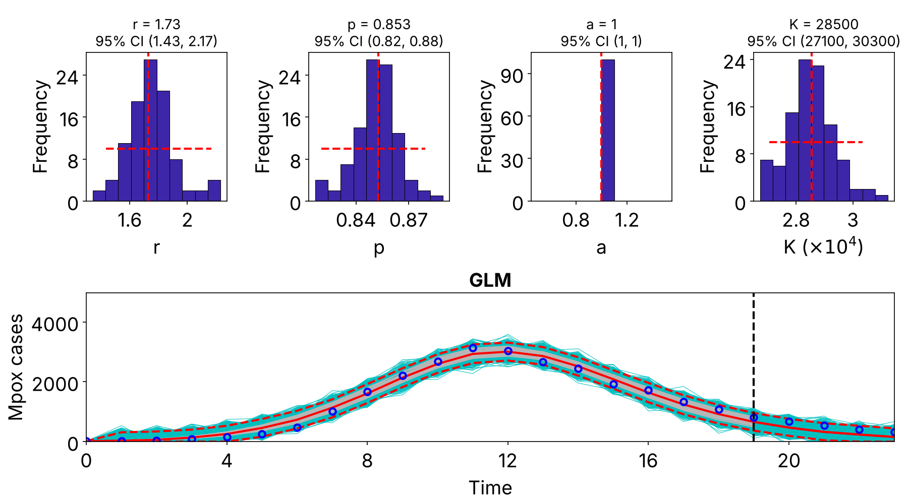
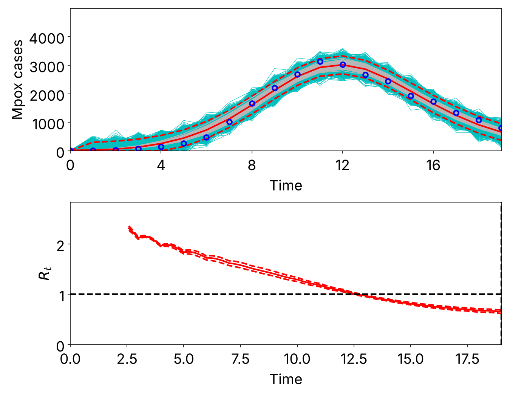

# GrowthPredict for Python

A Python port of the GrowthPredict MATLAB toolbox: fit phenomenological growth models to incidence data and forecast how many new events will occur in each of the next few observation intervals, with a parametric bootstrap for the uncertainty in parameters and predictions.

Functions keep their MATLAB names and argument order, and the output files keep their MATLAB names and layouts, so the [main README](../README.md) describes this port as well. This page covers what is specific to Python.

[Quick start](#quick-start) · [MATLAB to Python](#matlab-to-python) · [Options](#options) · [Differences from MATLAB](#differences-from-matlab) · [Tests and validation](#tests-and-validation)

## Installation

Python 3.9 or later with NumPy (1.22 or later), SciPy and Matplotlib. No MATLAB toolbox is needed. The port was written and tested with Python 3.13, NumPy 2.5, SciPy 1.18 and Matplotlib 3.11; it has not been run on older versions.

From the repository root:

```bash
pip install -e python
```

The editable install (`-e`) leaves the package in the repository, where it finds the example datasets in `forecasting_growthmodels code/input`. To use the package without installing it, run Python from the `python` folder.

## Quick start

Use the first 20 weeks of the bundled U.S. mpox case series to forecast weekly case counts for the next four weeks.

```python
import growthpredict as gp

gp.rng(1)                                     # MATLAB: rng(1, 'twister')
gp.Run_Forecasting_GrowthModels(1, 1, 20, 4)
gp.plotForecast_GrowthModels(1, 1, 20, 4)
```

<p align="center">
  
</p>

*Quick-start output of the Python port, laid out like the MATLAB figure. **Top:** bootstrap distributions of r, p, a and K, with the fit to the observed data (red dashed vertical line) and its 95% interval (red dashed horizontal segment). **Bottom:** observations (blue circles), bootstrap trajectories with observation noise (cyan), predictive median and 95% prediction limits (red), fitted calibration trajectories (grey) and the end of the calibration window (black dashed line).*

The runner writes its results to `./output`, in the folder Python is run from. The plotting function reads them, draws the figures and writes the per-window tables. To see or keep the figures:

```python
import matplotlib.pyplot as plt

plt.figure(101).savefig("forecast.png", dpi=150)   # figure 100 + window start
plt.show()                                         # in an interactive session
```

Open the trajectory file to see the forecasts beside the four held-out counts (669, 546, 404 and 329):

```python
names, trajectory = gp.io.readtable(
    "output/Forecast-flag1-1-fixI0-1-method-0-dist-0-tstart-1-calibrationperiod-20-horizon-4-Mpox-cases.csv")
print(names)                 # ['time', 'data', 'median', 'LB', 'UB']
print(trajectory[-4:])
```

The fit-only analysis, the reproduction number and the rolling windows follow the main README:

```python
gp.rng(1)
gp.Run_Fit_GrowthModels(1, 1, 20)
gp.plotFit_GrowthModels(1, 1, 20)
gp.plotFit_ReproductionNumber(1, 1, 20, gp.options_fit, gp.options_Rt)

gp.rng(1)
gp.Run_Forecasting_GrowthModels(1, 6, 20, 4)       # six rolling windows
gp.plotForecast_GrowthModels(1, 6, 20, 4)
```

<p align="center">
  
</p>

`gp.make_readme_figures()` reruns these examples and writes the six figures to `python/docs/images` (about two minutes).

### Your own data

Place a numeric, headerless, two-column text file (time index, incidence) in `./input` and name it in the options. The loader looks in `./input` first and then among the example datasets of the repository. A file whose name begins with `cumulative` is differenced on load.

## MATLAB to Python

| MATLAB | Python |
| --- | --- |
| `rng(1, 'twister')` | `gp.rng(1)` |
| `Run_Fit_GrowthModels(1, 1, 20)` | `gp.Run_Fit_GrowthModels(1, 1, 20)` |
| `Run_Forecasting_GrowthModels(1, 1, 20, 4, @options_forecast_pois)` | `gp.Run_Forecasting_GrowthModels(1, 1, 20, 4, gp.options_forecast_pois)` |
| `Run_Fit_GrowthModels(1, 1, 20, [], struct('rBounds', [1e-3 50]))` | `gp.Run_Fit_GrowthModels(1, 1, 20, None, {'rBounds': [1e-3, 50]})` |
| `plotFit_ReproductionNumber(1, 1, 20, @options_fit, @options_Rt)` | `gp.plotFit_ReproductionNumber(1, 1, 20, gp.options_fit, gp.options_Rt)` |
| `[P, residual, fitcurve, ..., fitDiagnostics] = fit_model(data1, params0, fixI0, numstartpoints, DT, flag1, h, fitopts)` with `global method1` | `P, residual, fitcurve, ..., fitDiagnostics = gp.fit_model(data1, params0, fixI0, numstartpoints, DT, flag1, h, fitopts, method1=0)` |
| `[Rs, ts, giCoverage] = get_Rt(t, I, 1, meanGI, varGI)` | `Rs, ts, giCoverage = gp.get_Rt(t, I, 1, meanGI, varGI)` |
| `results = runtests('tests')` | `python -m pytest` |

Things that change with the language:

- **An empty argument is `None`**, where MATLAB uses `[]`. Each function returns its MATLAB outputs as a tuple, in the same order.
- **Window arguments stay one-based.** `Run_Fit_GrowthModels(13, 13, 20)` fits rows 13–32 of the file, as in MATLAB.
- **Array indices are zero-based.** `P[0]` is `r`; `Rs[k]` is the estimate at `ts[k+1]`, as in MATLAB; the row indices returned by `selectRtRows` are zero-based, so `ts[idxRows + 1]` gives the same times.
- **`method1` is not a global variable.** It is a field of the options and an argument of `fit_model`.
- **Errors and warnings** are `gp.GrowthPredictError` and `gp.GrowthPredictWarning`; both carry the MATLAB identifier, for example `err.identifier == 'GrowthPredict:fit_model:rBounds'`.
- **Folders and display** are keyword arguments of the runners and plotting functions: `input_dir='./input'`, `output_dir='./output'`, `verbose=True`, and for the runners `plot=True` and `rng=None` (a `numpy.random.Generator` of your own).

| Module | MATLAB files |
| --- | --- |
| `models.py` | `modifiedLogisticGrowth`, `growthIncidenceCurve`, `growthODEOptions` |
| `objective.py` | `growthObjective`, `growthObjectiveValue`, `plotModifiedLogisticGrowthMethods1` |
| `fitting.py` | `fit_model`, `initialParams` |
| `noise.py` | `AddErrorStructure`, `estimatePearsonDispersion`, `getMeanVarianceRatio` |
| `aicc.py` | `getAICc`, `get_nparams`, `growthAICcCountAdjustment` |
| `metrics.py` | `computeQuantiles`, `computeWIS`, `computeforecastperformance`, `boundHitFractions` |
| `rt.py` | `get_Rt`, `selectRtRows`, `options_Rt`, `options_Rt_mpox`, `options_Rt_cholera` |
| `doubling.py` | `getDoublingTimeCurve` |
| `options.py` | `options_fit*.m` (11) and `options_forecast*.m` (8) |
| `runners.py` | `Run_Fit_GrowthModels`, `Run_Forecasting_GrowthModels` |
| `plotting.py` | `plotFit_GrowthModels`, `plotForecast_GrowthModels`, `plotFit_ReproductionNumber`, `plotForecast_ReproductionNumber`, `plotRt`, `plotGrowthModel`, `plot_growth_illustration`, `forecastPanelGrid` |
| `titles.py` | `parameterTitleText`, `setParameterTitle`, `fitParameterTitles`, `addEstimateLine`, `GetAdjustedFontSize` |
| `make_readme_figures.py` | `make_readme_figures` |
| `utils.py`, `io.py` | `days2weeks`, `adjustLastWindowStart`; MATLAB's `quantile`, `smooth`, `load`, `save` and `writetable` |

The scripts in `forecasting_growthmodels code/legacy` are not ported.

## Options

An options function takes no input and returns a `gp.Options` object with the settings of the MATLAB options file: `cadfilename1`, `caddisease`, `datatype`, `method1`, `dist1`, `numstartpoints`, `B`, `flag1`, `model_name1`, `fixI0`, `getperformance`, `forecastingperiod`, `windowsize1`, `tstart1` and `tend1`. For the likelihood methods (`method1` = 1, 3, 4 or 5) `dist1` is set to `method1` automatically, as in the MATLAB files. All 19 bundled options files are available under their MATLAB names.

To keep a configuration of your own, write a function that returns a modified copy, and pass it to both the runner and the plotting function:

```python
def options_fit_mydata():
    return gp.options_fit().replace(cadfilename1="mydata", caddisease="Flu", datatype="cases",
                                    flag1=gp.GRM, method1=1, B=500, windowsize1=30)

gp.Run_Fit_GrowthModels(1, 1, 30, options_fit_mydata)
gp.plotFit_GrowthModels(1, 1, 30, options_fit_mydata)
```

A generation-interval function returns `(type_GId1, mean_GI1, var_GI1)`:

```python
def options_Rt_daily():
    return 1, 8.5, 5.0**2          # gamma, mean and variance in days
```

## Outputs

The files in `./output` have the names and columns given in the main README. The MAT files are written with `scipy.io.savemat` and hold the variables named there (`P_model1d`, `Phatss_model1`, `fitDiagnostics_model1d`, `forecast_model12`, `timevect2`, `dist1_boot`, `poissonFallback` and the others used by the plotting functions), not the whole workspace. Read one in Python with `gp.io.load_mat(path)`.

| Figure number | Contents |
| --- | --- |
| 100 + i | Parameter histograms, fit and forecast of the window starting at row i (runners, `plotForecast_GrowthModels`) |
| 101 + i | The same for a fit-only analysis (`plotFit_GrowthModels`, `plotFit_ReproductionNumber`) |
| 200 + i | MAE, MSE, coverage of the 95% prediction interval and WIS against horizon |
| 300 | Parameter estimates across rolling windows |
| 400 | One forecast panel per rolling window |
| 500 + k | Incidence above the reproduction number, k-th window |
| 601–604 | `plotRt`: series and reproduction number, parameters, calibration performance, AICc |

## Differences from MATLAB

The models, objectives, parameter bounds, seed, start-point design, bootstrap, scores, reproduction-number and doubling-time calculations are the same. These parts differ:

| Part | MATLAB | Python | Effect |
| --- | --- | --- | --- |
| Random numbers | `rng(1,'twister')` | `gp.rng(1)`, NumPy's generators | A seeded run repeats itself, but not the MATLAB run with the same seed. Estimates agree; bootstrap limits agree within Monte Carlo error. |
| Local optimizer | `fmincon`, `sqp` | SciPy `SLSQP`, restarted from its end point until the objective stops decreasing | Same optimum on the reference fits (see below). |
| Multi-start | `MultiStart`, Latin hypercube by `lhsdesign` (maximin) | The same start set built in NumPy; every start is run | `startAgreement` is the share of converged starts that reach the best objective. MATLAB computes it over the distinct local solutions that `MultiStart` returns, so the two values can differ. |
| ODE solver | `ode15s`, RelTol 1e-6, AbsTol 1e-8 | LSODA (`scipy.integrate.odeint`), RelTol 1e-8, AbsTol 1e-10 | At 1e-6 LSODA left the sums of squares of the reference fits off in the fifth digit, so the tolerances are tighter. |
| Parallel solves | `fitopts.useParallel` | Accepted, runs serially with one warning | None on results. |
| MAT files | Whole workspace | The variables used downstream | See [Outputs](#outputs). |
| Figures | Font size 24, `figure` numbers assigned by MATLAB for the summary | Font size 18 (`gp.titles.BASE_FONT_SIZE`), summary figure is number 300; powers of ten go into the axis label, e.g. `K (×10⁴)` | Appearance only. |

Three points where the port first departed from MATLAB v1.1.1 are now the same in both, because the MATLAB plotting functions were corrected (see [plot-windows.md](../docs/validation/plot-windows.md)):

- **Panel of forecasts with 16, 24, 32, … windows.** Figure 400 takes its rows and columns from `forecastPanelGrid`, which has a panel for every window, and it is kept open when the figures of earlier windows are closed.
- **Rolling-parameter figure.** All four panels read the arrays rebuilt from the plotted windows.
- **Last window start in the plotting functions.** They apply the rule of the runners (`adjustLastWindowStart`), so they look for the file names the runner wrote.

A runner or plotting function called with a first window beyond the last possible one returns empty results with a warning (`GrowthPredict:windows`); MATLAB prints `incompatible tstart and tend values`. A plotting function called before its runner raises `FileNotFoundError` naming the file it looked for.

## Tests and validation

From the `python` folder:

```bash
python -m pytest                    # 155 tests, about 2.5 minutes
python -m pytest -m "not slow"      # 123 tests without the end-to-end runs, about 20 seconds
```

| Test file | What it checks |
| --- | --- |
| `test_getRt.py`, `test_selectRtRows.py`, `test_optionsRt.py`, `test_doublingTime.py`, `test_gompertz.py`, `test_rInterval.py`, `test_parameterTitle.py`, `test_forecastPanelGrid.py`, `test_adjustLastWindowStart.py` | The nine MATLAB test files of `forecasting_growthmodels code/tests`, test for test, with the same reference values and tolerances |
| `test_models_objective.py` | Closed-form solutions of the exponential, generalized-growth, logistic, Richards and Gompertz models; Poisson and negative-binomial objectives against `scipy.stats`; AICc and parameter counts |
| `test_fit_model_options.py` | Outputs of `fit_model`, supplied bounds, optimizer settings, bounds of the error model, input checks |
| `test_noise_metrics.py` | Mean and variance of the six noise models; MATLAB's quantile definition; WIS, coverage, MAE and MSE against a direct calculation; bound-hit fractions |
| `test_utils_options.py` | Data loader, cumulative files, moving average, the 19 options functions |
| `test_runners.py` | Runners and plotting functions end to end: file names, table layouts, the README quick start, every estimation method and model, rolling windows, 16 and 24 windows in one panel figure, a last window start beyond the series, forecasts beyond the data, messages |

### Agreement with the MATLAB toolbox

The port was not run side by side with MATLAB: none was available where it was written. The comparison rests on the reference values in the MATLAB test files, on the MATLAB run recorded in the [validation notes](../docs/validation/README.md), and on the reference port of `fit_model.m` kept there. With MATLAB at hand, comparing `parameters-rollingwindow-*.csv` from the two quick starts is the direct check.

U.S. mpox series, GLM unless stated, least squares. "Reference" is the target in the MATLAB test file, or the MATLAB value in the validation notes where marked (M). The Python bootstrap used `B = 1000`.

| Check | Reference | Python |
| --- | --- | --- |
| Fit, rows 1–20: r, p, K, sum of squares | 1.7302, 0.8526, 28,547, 3.1779e5 | 1.7302, 0.8526, 28,547, 3.1779e5 |
| Fit, rows 13–32: r, p, K, sum of squares | 801.8, 0.178, 18,153, 2.323e4 (M) | 802.7, 0.1775, 18,153, 2.3225e4 |
| Same fit with `rBounds = [1e-3 10]` | r = 10, p = 0.676, 9.51e5 (M) | r = 10, p = 0.676, 9.51e5 |
| Fit, rows 8–27: r, sum of squares | 26.97, 9.24e4 | 26.97, 9.238e4 |
| Mean AICc of the fits to rows 12–31 and 13–32 (M, run of 27 Nov 2026) | 202.2048 (M) | 202.2040 |
| Gompertz fit, rows 1–20: r, a, sum of squares | 1.4738, 0.18763, 2.71708e6 | 1.4737, 0.18762, 2.71708e6 |
| Gompertz fit, rows 13–32: r, a, sum of squares | 0.6732, 0.3939, 4.525e5 (M) | 0.6732, 0.3939, 4.525e5 |
| Rows 1–20, bootstrap: r | 1.7 (1.5, 2.1) (M) | 1.73 (1.47, 2.06) |
| Rows 1–20, bootstrap: p | 0.85 (0.83, 0.87) (M) | 0.853 (0.829, 0.875) |
| Rows 13–32, bootstrap: r | 8e2 (5.7e2, 1.2e3) (M) | 803 (574, 1161) |
| Rt, exponential growth r = 0.3, cholera interval | 1.1822069459 | equal within 1e-6 |
| Rt of rows 13–32, first exported row (t = 15) | 0.850 (0.837, 0.863), coverage 0.9767 (M) | within 1.5% of 0.850, coverage 0.9767 |
| Rt of rows 13–32, last row (t = 31); rows exported | 0.721 (0.706, 0.735); 17 (M) | within 2% of 0.721; 17 |
| Doubling time of rows 13–32, count of the series | 15.61 (13.44, 17.32), reached by 100% (M) | within 4% of 15.61, reached by 100% |

The last three Python entries are the tolerances that `test_runners.py` asserts with `B = 100`.

### Agreement with the reference port of `fit_model.m`

`docs/validation/python/gp_port.py` is the independent re-implementation used to validate the MATLAB toolbox (its own integrator, SciPy least squares; it needs `numba`). `docs/validation/compare_with_reference_port.py` in this folder fits the same windows with it and with the package: three windows of 20 observations of each of the 17 bundled series with unit time spacing, all seven models, least squares and Poisson likelihood, 609 fits.

| Result | Fits |
| --- | ---: |
| Same objective value (relative difference at most 1e-4; median 5e-9) | 603 |
| Package higher by 0.04% to 0.2%: generalized Richards model, least squares; four of them along the ridge where `r` and `a` trade off as `a` approaches 0 | 5 |
| Package higher: logistic model on `simulated.txt`, start row 88 (counts of 0 to 8), which has two minima | 1 |
| Package lower | 0 |

In the two-minima case the package found the better minimum for 3 of 8 seeds with `numstartpoints = 10` and for all 8 with `numstartpoints = 40`; when it is found, at most 1 start in 14 reaches it and the runner warns (`GrowthPredict:StartAgreement`). The full listing is in [reference_port_comparison.txt](docs/validation/reference_port_comparison.txt).

## Citation and license

Chowell, G., Bleichrodt, A., Dahal, S., et al. (2024). GrowthPredict: A toolbox and tutorial-based primer for fitting and forecasting growth trajectories using phenomenological growth models. *Scientific Reports*, **14**, 1630. [Tutorial paper](https://doi.org/10.1038/s41598-024-51852-8)

Distributed under the GNU General Public License v3.0 only, like the MATLAB toolbox. [License](../LICENSE)
